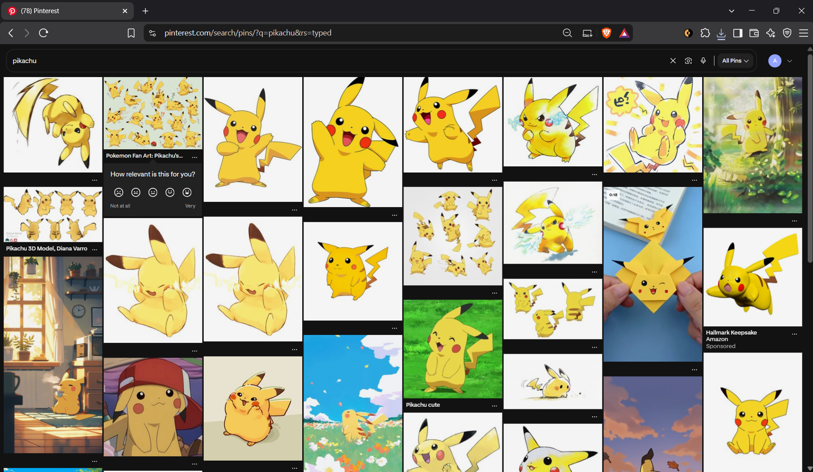
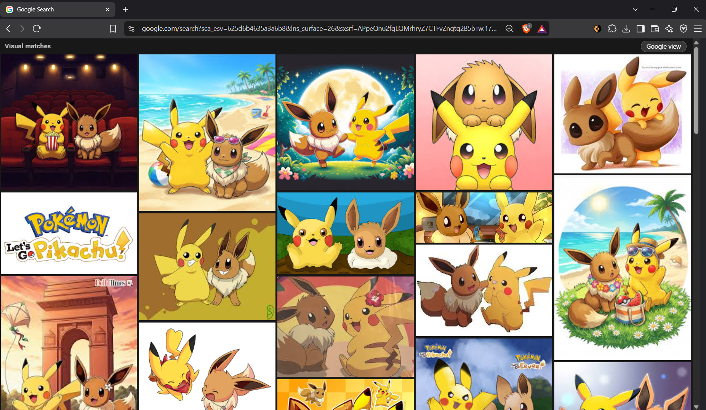
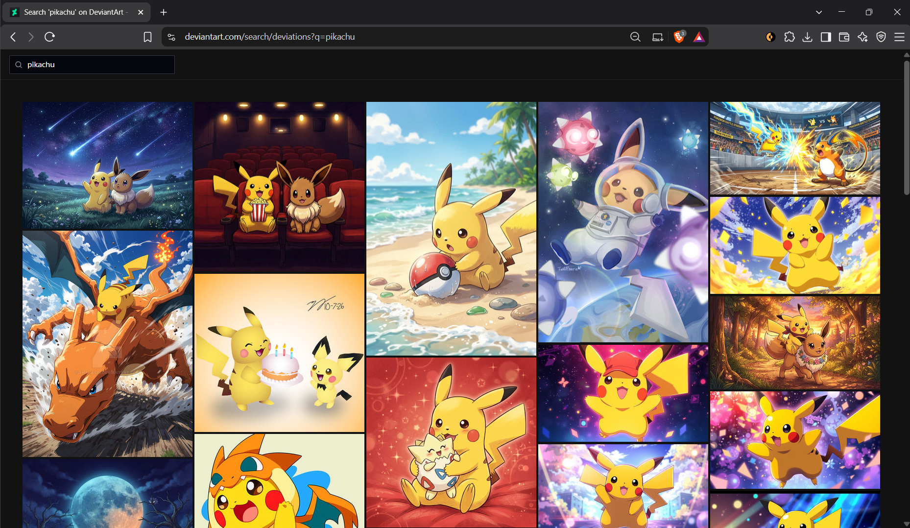
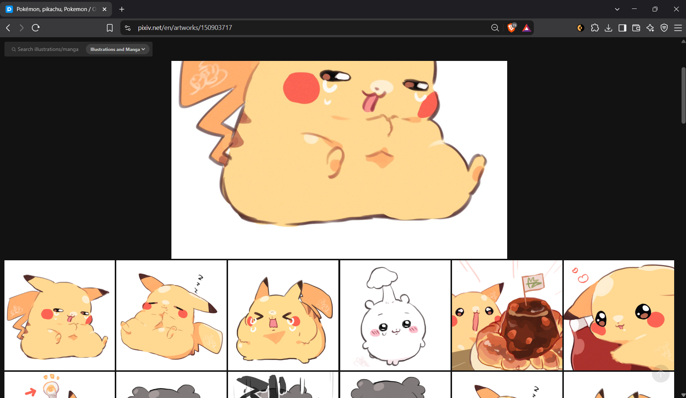

# Bravely

Bravely is **Pinfull's optional companion extension for Brave**. When you send an image from Pinfull to Google Lens, Bravely carries the same quiet image-wall experience into Lens visual matches. It also brings dark walls, full-size image actions and visual-search shortcuts to Pinterest, DeviantArt and pixiv.

Pinfull is a customized Pinless fork. On an image or GIF, its blue strip or **G while hovering** opens Google Lens; on a video, the blue strip opens the pin page. Both apps work independently. Pinfull's Google Lens image links can use Bravely's image-upload route without configuring a local server address in the extension.

**Status: public development preview, version 0.14.0.** This repository was extracted from the working Lens Wall extension. It is not a verified public release. See [release preparation](docs/RELEASE_PREPARATION.md) and [source provenance](NOTICE.md).

## In action

These owner-supplied screenshots show the wall experience on all four supported sites, using non-adult Pokémon artwork. They illustrate the browsing layout; they are not a full test of every action in this development preview. Website results can change, and Bravely does not filter adult content.

### Pinterest

Pikachu search results in the dark image wall.



### Google Lens

Visual matches in the wall view, continuing the image-search workflow from Pinfull.



### DeviantArt

Pikachu search results with the simplified wall layout.



### pixiv

An artwork page with a large image and related works below it.



The artwork and website branding shown belong to their respective creators and owners. These screenshots demonstrate the extension's layout and do not imply endorsement.

## Install in Brave

1. Clone or download this repository to a folder you will keep.
2. Open `brave://extensions` and enable **Developer mode**.
3. Select **Load unpacked** and choose the folder containing `manifest.json`.
4. Open or refresh a supported website. Use **Details > Extension options** to change each site's look and image actions.

For an installation archive on Windows, run `powershell -NoProfile -File scripts/Package.ps1`. Extract the generated `dist/bravely-0.14.0-unpacked.zip`, then load the extracted folder as above. The archive contains runtime files only.

If you already have Lens Wall installed, disable that extension before enabling Bravely on the same sites. Running both can duplicate page modifications. Loading a separate unpacked folder normally creates a separate extension identity, so its settings may start from defaults. Keep the old copy until the new one has been checked.

After an update, reload Bravely on `brave://extensions`, then refresh open website tabs. Removing the extension stops its modifications; refreshed pages return to the site's normal appearance.

## Controls

| Site | Action |
| --- | --- |
| Pinterest, DeviantArt, pixiv | `Ctrl+Shift+X` toggles Bravely's look and reloads the page. Avoid typing fields when using shortcuts. |
| Pinterest | `Ctrl+Shift+Z` opens the hovered pin in the same tab, waits for its controls, then activates Pinterest visual search. In its crop view, it returns to the pin. |
| DeviantArt | `Ctrl+Shift+Z` opens More Like This for the hovered/current artwork, or returns from that view. |
| pixiv | `Ctrl+Shift+Z` opens/jumps to related works; on an artwork page it switches between the artwork and related works. |
| Google Lens | Bravely selects Visual matches and displays an image wall. Google view / Wall switches views; `Ctrl+Shift+Z` opens the search-area editor or returns to the wall. |

On supported images, the **red strip** opens a larger/original image in a new tab. The **blue strip** searches that image with Google Lens. DeviantArt and pixiv options can make the blue strip open the artist's gallery instead. Image size and availability depend on what the source allows; a thumbnail may remain when a larger image cannot be fetched.

If a supported site looks completely normal, check its look switch first. The original DeviantArt artwork view was confirmed working after its disabled look was switched back on.

## Permissions and data

Bravely uses `storage` for extension preferences and `declarativeNetRequest` to route Lens uploads and supply pixiv's image-server referrer. Content scripts run on the supported Google Lens/search, Pinterest, DeviantArt and pixiv URLs listed in the manifest.

Required host access is limited to Google Lens/search, the supported art sites and their image servers. In **Extension options > Optional access**, two extra permissions start **off**:

- **Find images on other websites** requests access to other HTTPS sites for full-size discovery and Lens uploads.
- **Use images from local companion apps** requests HTTP access to `localhost` and `127.0.0.1` for local image endpoints.

Enable a switch yourself and approve the browser permission request to activate it. There are no automatic permission prompts on install, page load or failed image requests. Declining leaves access off; switching off revokes the optional permission. Opt-ins are stored locally, not synced between installations. Upgrading from 0.13.0 removes unselected legacy broad grants rather than treating them as approval.

With extras off, the supported image servers still work. Other full-size lookups may keep the thumbnail, and blocked Lens image sources show an explanation and an options button. Ordinary Pinfull links to Pinterest-hosted images need no localhost permission. Failed local-image requests never fall back to sending the local URL to Google. Extension fetches reject redirects to avoid silently crossing the selected access boundary, so sources requiring redirects may keep their thumbnail even with extra access enabled.

Selecting a Lens action sends the selected image to Google Lens: Bravely fetches the image and submits it to Google's upload endpoint. Full-size actions can request a source page and candidate images to find a larger match. Website browsing, authentication and Google's processing are handled by those services. Debug logging is off by default; enabling it can print page markup in the browser console.

The extension has no bundled account credentials or required Docker services. Preferences retain legacy internal storage keys for compatibility; the visible product name is Bravely. Retired Priviblur routing and its local-address option were removed in this preparation copy, so Tumblr results open their original source URLs.

## Development

Use Node.js 22 or newer. There are no npm dependencies to install.

```sh
npm test
```

The checks validate manifest references, JavaScript syntax, image URL helpers, Pinterest layout simulations and visual-search navigation. They do **not** replace testing the installed extension against real authenticated pages.

Runtime files live at the repository root. `tests/` contains local regression checks; `scripts/` contains validation and packaging tools. The manifest defines which site scripts run and whether they run in the isolated or page world. Keep that order and execution-world distinction when changing the extension.

When reporting a bug, include the site/page type, whether you were signed in, Bravely's version and look-switch state, the expected result, and a screenshot without private information.

## Known limitations

- Website layout changes can break wall recognition or image actions.
- Some source pages cannot expose a larger image, and authenticated content still requires access on the source site.
- Signed-in Pinterest panel and two-step visual-search behavior need a fresh installed-Bravely check.
- pixiv and DeviantArt need broader authenticated scrolling checks; earlier Lens Wall results are recorded separately from this renamed copy.
- Final extension artwork/icons, license selection and provenance review remain preparation work.

No public release tag is provided by this preparation snapshot.
